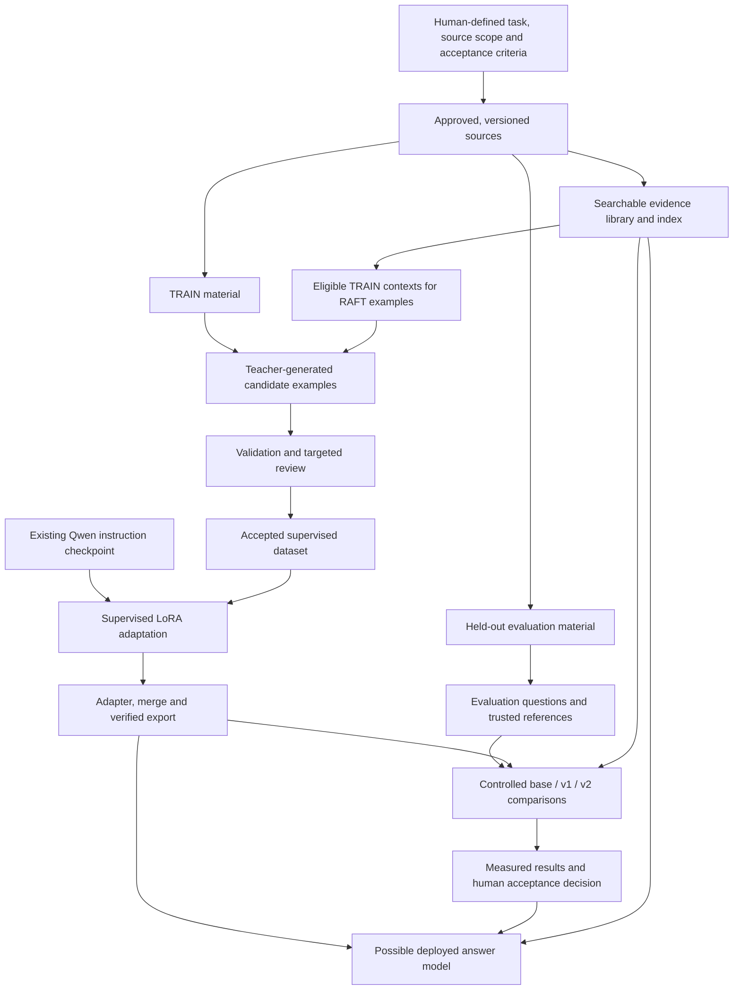

# Machine Learning Guide — From software development to a defensible fine-tuning experiment

This guide explains the principles behind the project's **RAG + RAFT + Qwen fine-tuning** architecture. It is written for a software developer who can build applications but is new to machine learning.

The goal is not to memorize a pipeline or become a research scientist before building anything. It is to understand what each operation changes, what evidence supports a claim, and how to choose an appropriate approach for another project.

**This is a conceptual learning guide, not a code walkthrough or live job-status report.** Project settings illustrate general ideas; they are not universal recommendations. No completed v2 model or improvement over v1 is claimed here.

## What you should be able to explain afterward

- What a model learns, what its parameters are, and what happens during inference.
- How sources, supervised examples, an index and evaluation questions differ.
- Why loss, gradients and optimization can improve a task without becoming explicit rules.
- Why train/validation/test boundaries matter and how leakage makes results misleading.
- How embeddings, RAG, RAFT and LoRA fit together without being the same operation.
- How to evaluate a change against baselines and identify when human judgment is necessary.
- How to plan a bounded, measurable ML experiment instead of hoping that more data means a better model.

## Recommended reading order

Each teaching module includes learning goals, an explanation of the underlying idea, an application to this project, brief alternatives, self-checks with answers and a professional summary sentence.

| Module | Main question |
|---|---|
| [01 — Problem framing](01-problem-framing.md) | What are we asking the system to learn, and why use ML? |
| [02 — Models, tokens and inference](02-models-tokens-and-inference.md) | What does a language model actually compute? |
| [03 — Data and supervision](03-data-and-supervision.md) | Where does the learning signal come from? |
| [04 — How learning works](04-how-learning-works.md) | How do examples become parameter updates? |
| [05 — Splits, leakage and generalization](05-splits-leakage-and-generalization.md) | How do we know it learned more than the training examples? |
| [06 — Embeddings, RAG and RAFT](06-embeddings-rag-and-raft.md) | How do external evidence and learned behavior interact? |
| [07 — Fine-tuning, LoRA and export](07-fine-tuning-lora-and-export.md) | What do we train, merge and deploy? |
| [08 — Evaluation and human judgment](08-evaluation-and-human-judgment.md) | What would justify saying v2 is better? |
| [09 — Lifecycle and reproducibility](09-lifecycle-and-reproducibility.md) | How do we turn experiments into reliable artifacts? |
| [10 — Designing your next project](10-designing-your-next-project.md) | Which method should a new problem use? |
| [11 — Glossary](11-glossary.md) | What do these terms mean, and which ones are easy to confuse? |

**Foundation-first path:** read 01–05 before the architecture-heavy modules. These concepts transfer to classification, prediction and other ML tasks beyond language models.

**Architecture orientation:** read this page, then 06 → 07 → 08 → 09. Return to 01–05 for the underlying learning concepts.

**Planning a new application:** read 01 → 05 → 08 → 10, using the glossary as needed. Do not skip evaluation simply because training has not started.

A useful study habit is to answer the self-checks before revealing their answers. Then explain the concept using a different application. If you can explain why the same principle applies there, you are learning the method rather than the project settings.

## The whole system in one picture

The diagram compresses several stages. Evaluation questions and trusted references remain outside student training. The index may supply permitted evidence in an open-book benchmark; it must not supply hidden answer keys. Deploying remains conditional on measured results and the intended use.

### The five sentences that untangle the pipeline

1. **Indexing** makes source material searchable; it does not train Qwen.
2. **Dataset generation** creates input/target examples; it does not yet change Qwen's parameters.
3. **Fine-tuning** updates the student adapter using those examples.
4. **Merging and export** package learned weights for compatible inference; they do not create new supervision.
5. **RAG at inference** retrieves evidence for each question and supplies it to the answer model.

RAFT belongs to sentence 2 and the training that follows: some supervised examples deliberately include supporting and distracting context so the student practices evidence-conditioned behavior.

## How this project's choices illustrate the principles

This is an architectural snapshot, not confirmation that every planned stage has executed.

| Project choice | Principle it illustrates |
|---|---|
| Start from Qwen2.5-7B-Instruct | Transfer learning instead of training a language model from scratch |
| Seven official records and nine historically scoped legal instruments | A bounded evidence domain, source provenance and explicit version limits |
| Hybrid BM25 + BGE retrieval | Combining exact lexical matches with learned semantic representations |
| Six complementary training slices | Supervision should cover the behaviors and error cases the task needs |
| Sol-generated training candidates and Luna-generated evaluation candidates | Scalable synthetic data, with same-family correlation and quality limitations |
| RAFT examples with useful and distracting passages | Teach selective evidence use and appropriate insufficiency behavior |
| Fresh-from-base bf16 LoRA for v2 | Parameter-efficient supervised adaptation, not stacking the new adapter on v1 |
| Separate evaluation under plain and RAG conditions | Distinguish the contribution of adaptation from the contribution of evidence access |
| Bounded 300-training/50-evaluation pilot | Inspect feasibility, yield and quality before authorizing a larger experiment |

The pilot counts are **requested outputs**, not a guarantee of accepted examples. The full 3,650-training/1,100-evaluation targets are separate. Nothing about writing this guide starts paid generation or training.

## A running example that is easier to reason about

Several modules use a fictional equipment-support policy: returns within 30 days, with specified receipt evidence and versioned conditions. It is only a teaching example, not an actual source or a proposed business policy.

This example makes the important distinctions visible:

- A policy is source material.
- A question plus desired answer is a supervised example.
- A vector helps retrieve a policy passage; it does not establish eligibility.
- Missing receipt information can justify asking for evidence, not inventing it.
- A policy revision may require a retrieval update rather than another training run.

Then each module maps the concept back to the actual architecture without making you read implementation files.

## What AI can accelerate—and what still needs accountability

AI can draft examples, suggest rubrics, triage failures and help implement an experiment. It cannot independently establish that every generated label is correct simply by agreeing with its own output.

Humans remain responsible for defining useful tasks, selecting trusted references, reviewing consequential interpretations and accepting or rejecting the measured result. That does **not** mean every line of source text or every generated example must be manually written. The practical goal is to concentrate qualified review where it most affects quality.

This guide teaches the language needed to distinguish a promising prototype, an operationally ready pipeline and an empirically validated model. They are different milestones.

## When you need implementation or current status

The conceptual guide is deliberately separate from these existing project references:

- [v2 design and delivery specification](../Fine-Tuning_v2.md)
- [Architecture and resources](../ARCHITECTURE_V1_AND_RESOURCES.md)
- [Operational runbook](../v2/RUNBOOK_V2.md)
- [Dataset-generation status snapshot](../DATASET_GENERATION_STATUS_2026-10-18.md)

A recorded status can become stale. Use the runbook and current run artifacts when deciding whether a live job has finished or a paid stage is ready.

**Start learning:** [Module 01 — Problem framing](01-problem-framing.md).
